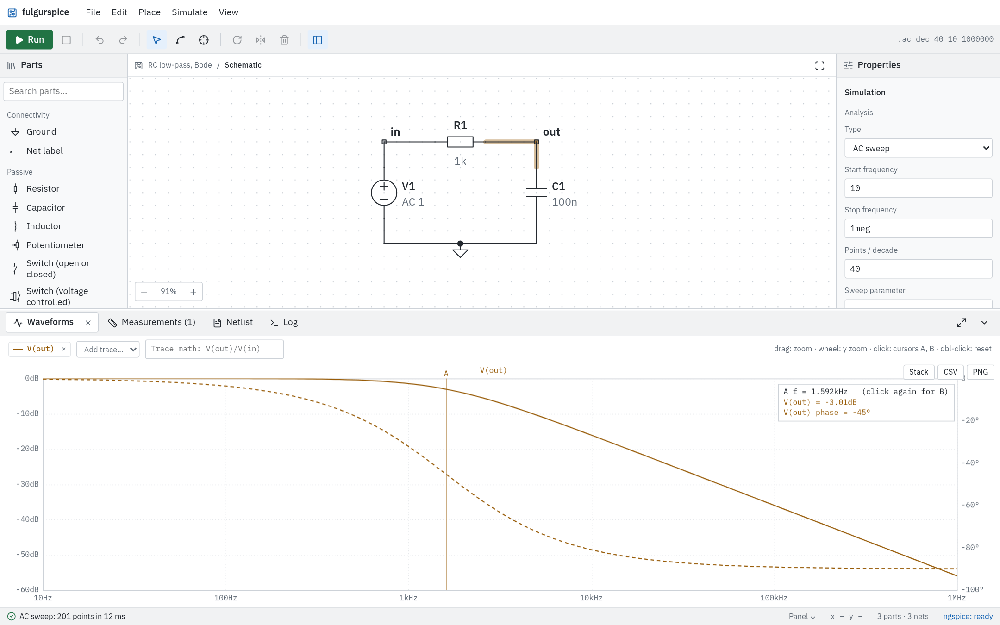

# fulgurspice

A circuit simulator for the browser: draw a schematic the way you would in KiCad, simulate it with
real SPICE (ngspice compiled to WebAssembly), and read the result in an LTspice-style waveform
viewer. Nothing is sent to a server. Built as the electronics counterpart to
[fulgurlab](../fulgurlab) for scope.io.




## Getting started

```bash
npm install
npm run dev        # http://localhost:5174
npm test           # netlister + real ngspice, in Node
npm run build      # typecheck + production bundle in dist/
```

Open **File > Examples**, press **Run** (F5), then pick the probe (P) and click a wire or a part.

## How it works

```
schematic (JSON, integer grid) ──compile()──► SPICE netlist ──► ngspice-wasm in a Web Worker ──► vectors ──► plot
        src/core/types.ts        src/core/netlist.ts              src/sim/worker.ts          src/sim/result.ts
```

The netlist text is the only interface between the editor and the engine, so the same netlist runs
in the browser, on a grading server, or in desktop ngspice.

| Folder | What lives there |
|---|---|
| `src/core/` | Pure TypeScript, no DOM: units, symbol library, netlister + rule checks, examples |
| `src/sim/` | The ngspice worker, its client, and result normalisation |
| `src/ui/` | React: schematic canvas (SVG), waveform viewer (canvas), parts library, inspector |
| `test/` | `core.test.ts` (netlister, units) and `engine.test.ts` (examples through real ngspice) |

## What works today

- Parts: R, C, L, voltage and current sources, diode, NPN/PNP, N/P MOSFET, ideal op-amp, ground, net labels
- Wiring on a grid with automatic junctions; rotate, mirror, move, delete, undo/redo; autosave; open/save JSON
- Analyses: transient, AC sweep (magnitude in dB and phase), DC sweep, operating point (voltages written on the schematic)
- Probing: click a wire for its voltage, a part for its current; voltages left axis, currents right axis
- Rule checks before the engine runs: no ground, unconnected pins, duplicate references, bad values
- ngspice warnings explained in plain language (floating node, missing model, no convergence)

## Measured (2026-11-13)

| What | Result |
|---|---|
| Engine start, Node 22 | about 350 ms |
| First Run in Chrome, engine not yet loaded (local preview) | about 1.1 s wall clock |
| RC transient, 512 points | 20 to 35 ms |
| Engine chunk | 20.2 MB uncompressed, fetched lazily by the worker; app bundle 277 kB (88 kB gzip) |

## Known limits

- Moving a part does not drag its wires along.
- Device models are generic ones written for this project (`DGEN`, `NPN_GEN`, ...), not vendor parts.
- The plain op-amp is ideal and never clips. The one with supply pins clips at its rails but models no slew rate or output current limit.
- `sqrt()` of a negative signal in a behavioural source stalls ngspice; the app stops the run after 60 s.
- AC analysis plots voltages only (ngspice cannot save device currents there).
- A slow network pays for the 20 MB engine on first load; there is no offline cache yet.

See [TASKS.md](TASKS.md) for what is next.

## Credits

Simulation by [ngspice](https://ngspice.sourceforge.io/) through
[eecircuit-engine](https://github.com/eelab-dev/EEcircuit-engine) (MIT).
