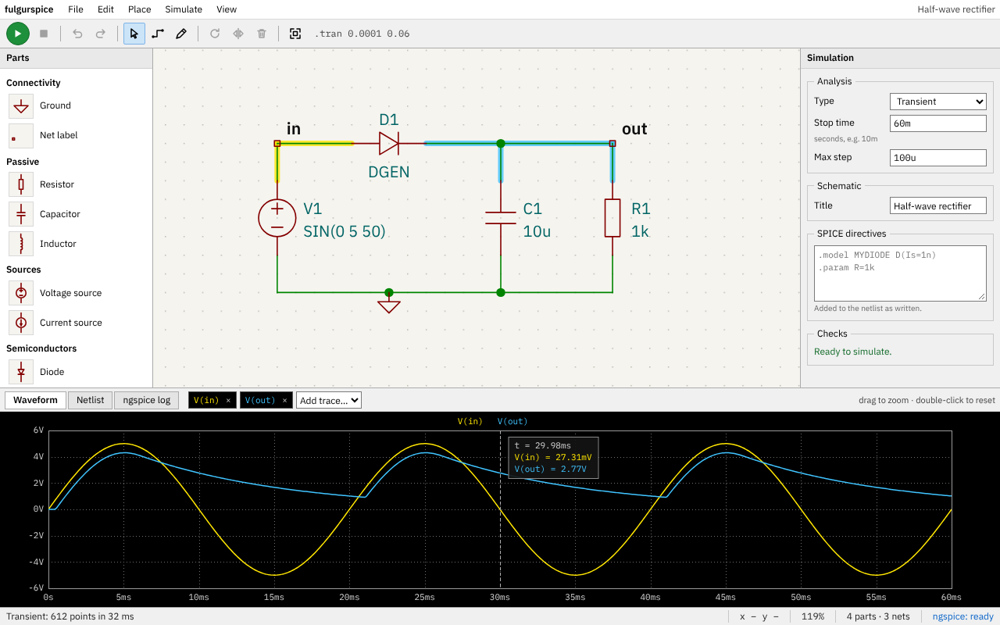

# fulgurspice

A circuit simulator for the browser: draw a schematic the way you would in KiCad, simulate it with
real SPICE (ngspice compiled to WebAssembly), and read the result in an LTspice-style waveform
viewer. The simulation runs on your own machine: no circuit is sent to a server. Built as the
electronics counterpart to fulgurlab for scope.io.




**New here?** Read **[How to use fulgurspice](docs/how-to-use.md)**: SPICE and the app from the
beginning, with screenshots and worked examples.

## Getting started

```bash
npm install
npm run dev        # http://localhost:5174
npm test           # netlister + real ngspice, in Node
npm run build      # typecheck + production bundle in dist/
```

Open **File > Examples**, press **Run** (F5), then pick the probe (P) and click a wire or a part.

## What works today

| Area | Included |
|---|---|
| Passive parts | R, C, L, potentiometer, manual and voltage-controlled switch, transformer |
| Sources | voltage and current (DC, sine, pulse, piecewise linear, AC) with a source editor; controlled sources E, G, F, H; behavioural source B |
| Semiconductors | diode, zener, LED, NPN, PNP, N and P MOSFET, ideal op-amp, op-amp with supply pins that clips |
| Drawing | grid wiring with automatic junctions; rotate, mirror, drag with wires following, box select, copy and paste, undo and redo |
| Subcircuits | draw one as a sheet or make one from a selection; parameters; test bench parts |
| Analyses | transient, AC (magnitude and phase), DC sweep, operating point (voltages written on the schematic), parameter sweeps |
| Waveforms | probe voltages and currents, two cursors, trace math, stacked panes, zoom, CSV and PNG export |
| Measurements | `.meas` lines, listed in their own tab |
| Checks | no ground, unconnected pins, duplicate references, bad values, AC sweep without an AC source, impossible source loops, floating nodes; ngspice messages explained in plain language |
| Files | autosave in the browser; open and save `.fspice.json` |

## How it works

```
schematic (JSON, integer grid) ──compile()──► SPICE netlist ──► ngspice-wasm in a Web Worker ──► vectors ──► plot
        src/core/types.ts        src/core/netlist.ts              src/sim/worker.ts          src/sim/result.ts
```

The netlist text is the only interface between the editor and the engine, so the same netlist can run
in the browser, on a grading server, or in desktop ngspice.

| Folder | What lives there |
|---|---|
| `src/core/` | Pure TypeScript, no DOM: units, symbol library, netlister and rule checks, subcircuits, examples |
| `src/sim/` | The ngspice worker, its client, result normalisation, trace math and measurements |
| `src/ui/` | React: schematic canvas (SVG), waveform viewer (canvas), parts library, properties |
| `test/` | Netlister, analysis, per-part and example tests; the engine tests run real ngspice |
| `docs/` | [How-to guide](docs/how-to-use.md), example circuits, screenshots, [model licence notes](docs/model-licences.md) |

## Using it in scope.io

scope.io frames the app and drives it with its `scopeio:*` postMessage protocol: the problem's
starter schematic goes in, and Submit sends back the schematic plus the graded net resampled for the
grader. Parts can be locked for learners, and the analysis is fixed by the problem.
[docs/embedding.md](docs/embedding.md) has the messages.

## Deploying

The app is a static site. `npm run build` writes it to `dist/`, which any web server can serve.
On GitHub, every push and pull request to `main` runs the tests and the build. When a push to `main`
passes, a second workflow deploys it to the project's own VM by running `deploy.sh`, which builds
`origin/main` in a Node container and copies the result into nginx's web root.

## Measured (2026-11-25)

| What | Result |
|---|---|
| Engine start, Node 22, one run | 514 ms |
| RC transient, 512 points, Node, 12 runs | median about 8 ms (first run 38 ms) |
| Page open to first result, headless Chrome, local preview build, 5 runs | 1.3 to 1.5 s (HTTP cache disabled) |
| Engine chunk | 20.2 MB uncompressed, fetched by the worker |
| App bundle | 358 kB (116 kB gzip), plus 30 kB CSS and the fonts |

## Known limits

- Device models are generic ones written for this project (`DGEN`, `NPN_GEN`, ...), not vendor parts.
- The ideal op-amp never clips. The one with supply pins clips at its rails but models no slew rate or output current limit.
- AC analysis plots voltages only (ngspice cannot save device currents there).
- `.meas` cannot read a part current; measure through a 0 V voltage source.
- SPICE directives are not checked. A mistake there can stall ngspice; the app stops a run after 60 s.
- In a behavioural source, `limit()` is refused because ngspice does not clamp with it (use `min(max(x, lo), hi)`), and `sqrt()` of a negative signal stalls the run.
- A slow network pays for the 20 MB engine on first load; there is no offline cache yet.

## Future work

- **Real part models** (1N4148, 2N3904/3906, 2N7000, LM358, TL072). Shelved: no vendor terms read
  allow bundling their files ([notes](docs/model-licences.md)). The likely route is our own models
  fitted to datasheet figures.
- Server-side grading for scope.io: re-run submissions in a hardened container instead of trusting the browser's capture.
- Offline caching of the engine; import of LTspice and KiCad files.

[TASKS.md](TASKS.md) has the full list.

## Credits

Simulation by [ngspice](https://ngspice.sourceforge.io/) through
[eecircuit-engine](https://github.com/eelab-dev/EEcircuit-engine) (MIT). Icons from
[Lucide](https://lucide.dev/) (ISC).
