# How to use fulgurspice

This guide teaches two things together: how **SPICE** thinks about a circuit, and how to drive
**fulgurspice** to simulate one. It assumes you know what a resistor and a capacitor do, and nothing
about SPICE.

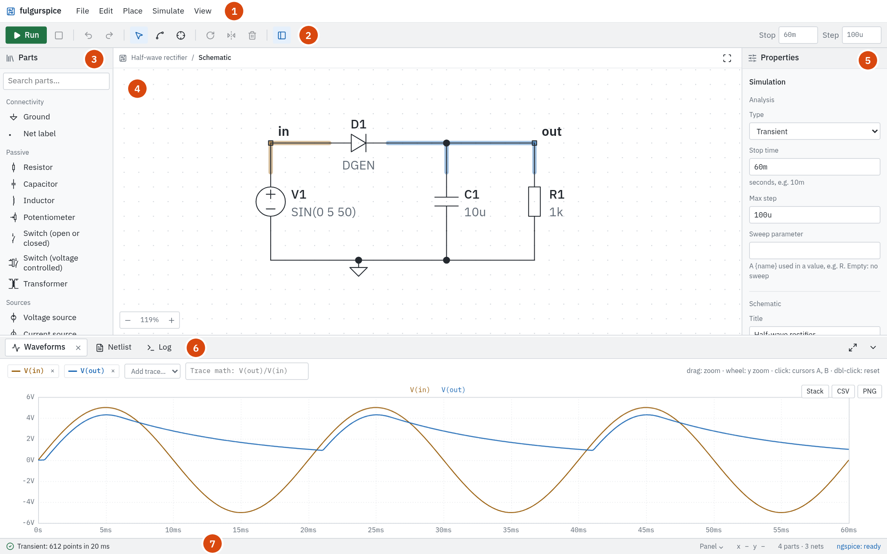

## Contents

1. [SPICE in five ideas](#1-spice-in-five-ideas)
2. [The window](#2-the-window)
3. [Your first circuit](#3-your-first-circuit)
4. [Operating point: the voltage divider](#4-operating-point-the-voltage-divider)
5. [Transient: watching a capacitor charge](#5-transient-watching-a-capacitor-charge)
6. [AC sweep: the frequency response](#6-ac-sweep-the-frequency-response)
7. [DC sweep: diode curves](#7-dc-sweep-diode-curves)
8. [Probing, currents and trace math](#8-probing-currents-and-trace-math)
9. [Parameter sweeps](#9-parameter-sweeps)
10. [A transistor amplifier](#10-a-transistor-amplifier)
11. [An op-amp that clips](#11-an-op-amp-that-clips)
12. [Subcircuits](#12-subcircuits)
13. [When something is wrong](#13-when-something-is-wrong)
14. [Reference: parts](#14-reference-parts)
15. [Reference: sources](#15-reference-sources)
16. [Reference: SPICE directives](#16-reference-spice-directives)
17. [Reference: editor and plot](#17-reference-editor-and-plot)
18. [Taking your netlist elsewhere](#18-taking-your-netlist-elsewhere)

The circuits used here are either under **File > Examples** or in [`docs/examples/`](examples/):
download one and open it with **File > Open…**.

## 1. SPICE in five ideas

SPICE (Simulation Program with Integrated Circuit Emphasis) is the circuit solver that most
electronics tools are built on. fulgurspice uses [ngspice](https://ngspice.sourceforge.io/),
running inside your browser.

### The circuit is a text file

SPICE never sees your drawing. It reads a **netlist**: one line per part, saying which nodes the part
connects and what its value is. This is the netlist of the first circuit you will build:

```spice
* My first circuit
V1 in 0 SIN(0 1 1k)
R1 out in 1000
C1 out 0 1e-7
.options savecurrents
.tran 0.00001 0.005
.end
```

| Line | Meaning |
|---|---|
| `* My first circuit` | the title (a comment) |
| `V1 in 0 SIN(0 1 1k)` | voltage source `V1` from node `in` to node `0`: a 1 V, 1 kHz sine |
| `R1 out in 1000` | 1000 Ω resistor between `out` and `in` |
| `C1 out 0 1e-7` | 100 nF capacitor between `out` and ground |
| `.options savecurrents` | keep the current of every part, not only the voltages |
| `.tran 0.00001 0.005` | simulate 5 ms of time, with 10 µs steps |
| `.end` | end of the file |

**The first letter of a name says what the part is**: `R` resistor, `C` capacitor, `L` inductor,
`V` voltage source, `I` current source, `D` diode, `Q` bipolar transistor, `M` MOSFET, `X` subcircuit.
Lines starting with a dot are commands.

fulgurspice writes this file for you from the schematic. You can read it at any time in the
**Netlist** tab, and reading it is the quickest way to learn SPICE.

### Every voltage is measured from node 0

A voltage is always a difference between two points. SPICE picks one point, node `0`, and reports
every other node relative to it. **A circuit without a ground symbol cannot be simulated.**

### Nodes have names

Everything connected by wires is one node. A **net label** gives a node a name (`in`, `out`, `vcc`).
Labels with the same name are the same node, even with no wire between them. Unlabelled nodes are
named `n1`, `n2`, and so on. ngspice ignores upper and lower case, so names appear in lower case.

### Numbers use SPICE suffixes

| Suffix | Factor | Example |
|---|---|---|
| `t` | 10¹² | |
| `g` | 10⁹ | `1G` = 1 000 000 000 |
| `meg` | 10⁶ | `1meg` = 1 000 000 |
| `k` | 10³ | `4.7k` = 4700 |
| `m` | 10⁻³ | `10m` = 0.01 |
| `u` or `µ` | 10⁻⁶ | `10u` = 0.00001 |
| `n` | 10⁻⁹ | `100n` |
| `p` | 10⁻¹² | `22p` |
| `f` | 10⁻¹⁵ | |

> **Three traps**
> - `M` is **milli**, not mega. `1M` is 0.001. Write `1meg` for a megohm or a megahertz. (The plot
>   axes print results the SI way, where `1MHz` is a megahertz.)
> - Unit letters after the suffix are ignored: `10uF` is `10u`. But `1F` is **one femto**, not one farad. Write `1`.
> - `4k7` works in a resistor, capacitor or inductor value, because the app rewrites it. **Do not use
>   it anywhere else.** In sources the app refuses it, and in SPICE directives ngspice can stall on it.
>   Write `4.7k`.

### An analysis asks one question

| Analysis | SPICE | The question | Sweeps |
|---|---|---|---|
| Operating point | `.op` | What are the DC voltages and currents? | nothing |
| Transient | `.tran` | What happens over time? | time |
| AC sweep | `.ac` | How does the response change with frequency? | frequency |
| DC sweep | `.dc` | What happens as a source's DC value changes? | a source |

## 2. The window

The numbers match the screenshot at the top of this page.

| # | Area | What it does |
|---|---|---|
| 1 | Menu bar | **File** (new, open, save, examples), **Edit**, **Place**, **Simulate**, **View** |
| 2 | Toolbar | **Run**, Stop, undo/redo, select, wire, probe, rotate, mirror, delete, parts library. The **Stop** and **Step** fields on the right appear for a transient analysis |
| 3 | Parts library | Search, then click a part to place it |
| 4 | Sheet | Where you draw |
| 5 | Properties | The selected part's values. With nothing selected: the analysis, the title, **SPICE directives** and the **Checks** list |
| 6 | Results panel | **Waveforms**, **Measurements** (when you have `.meas` lines), **Netlist**, **Log** (what ngspice printed) |
| 7 | Status bar | What just happened, cursor position, part and net count, engine state |

Drag the top edge of the results panel to resize it. `Ctrl+J` hides and shows it.

The engine is a 20 MB download. It starts shortly after the page opens, and the status bar says
`ngspice: ready` when it has arrived.

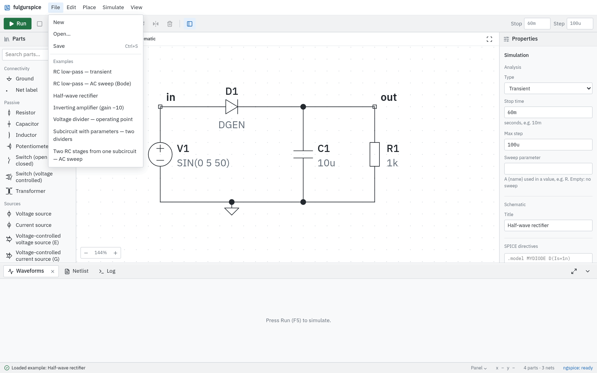

## 3. Your first circuit

You will draw an RC low-pass filter, run it, and read the result. A low-pass filter lets slow
signals through and weakens fast ones.

### Step 1: place the parts

Choose **File > New**. Press **`A`**, type part of a name, and press `Enter`. The part now follows the
pointer: click to put it down, then press `Esc`.

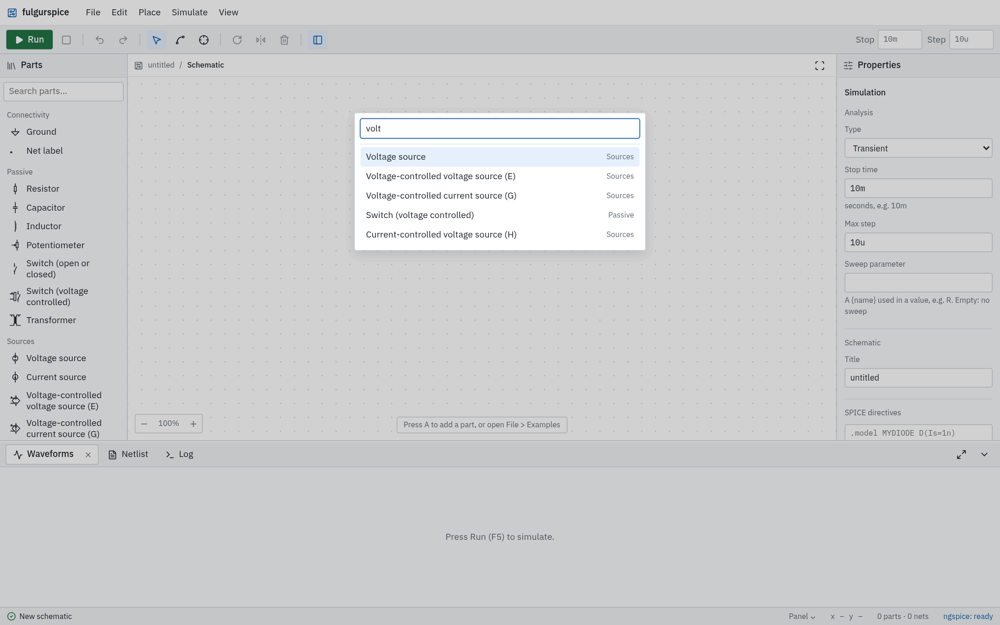

Place these four. While a part is on the pointer, **`R`** rotates it and **`X`** mirrors it.

| Type | Part | Note |
|---|---|---|
| `volt` | Voltage source | starts as a 1 V, 1 kHz sine, which is what we want |
| `res` | Resistor | press `R` once so it lies flat |
| `cap` | Capacitor | |
| `gnd` | Ground | below the other three |

Press **`F`** to fit the drawing to the window. Parts with unconnected pins are drawn in red, and each
open pin has a small circle.

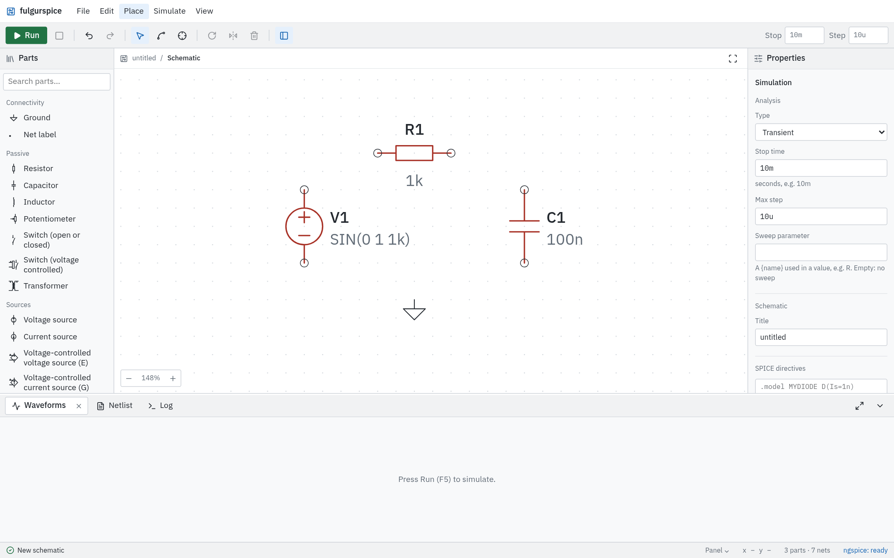

### Step 2: wire them

Press **`W`**. Click where the wire starts, then click where it ends.

- A wire runs **horizontally first, then vertically**.
- To choose where it bends, click the corner as a stop on the way.
- Clicking a pin or a wire finishes the wire. Clicking empty sheet carries on from there.
- `Esc` or a right-click stops.

Connect the top of `V1` to one end of `R1`, the other end of `R1` to the top of `C1`, and the bottoms
of `V1` and `C1` to the ground symbol.

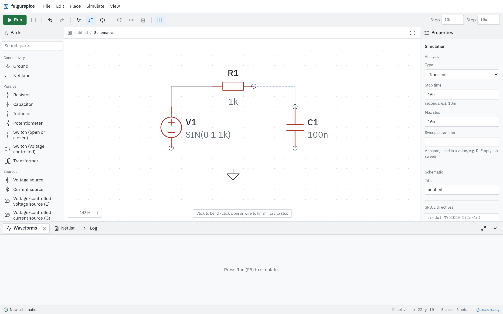

A filled dot appears where three or more connections meet. **Two wires that only cross are not
connected**; a wire end or pin that touches a wire is.

### Step 3: name the nodes

Press `A`, type `label`, and click the wire between `V1` and `R1`. Place a second label on the wire
between `R1` and `C1`. Click a label and set **Net name** to `in` for the first and `out` for the second.

Click empty sheet, then set **Title** to `My first circuit` and the toolbar **Stop** field to `5m`.
At the bottom of Properties, **Checks** should read *Ready to simulate*.

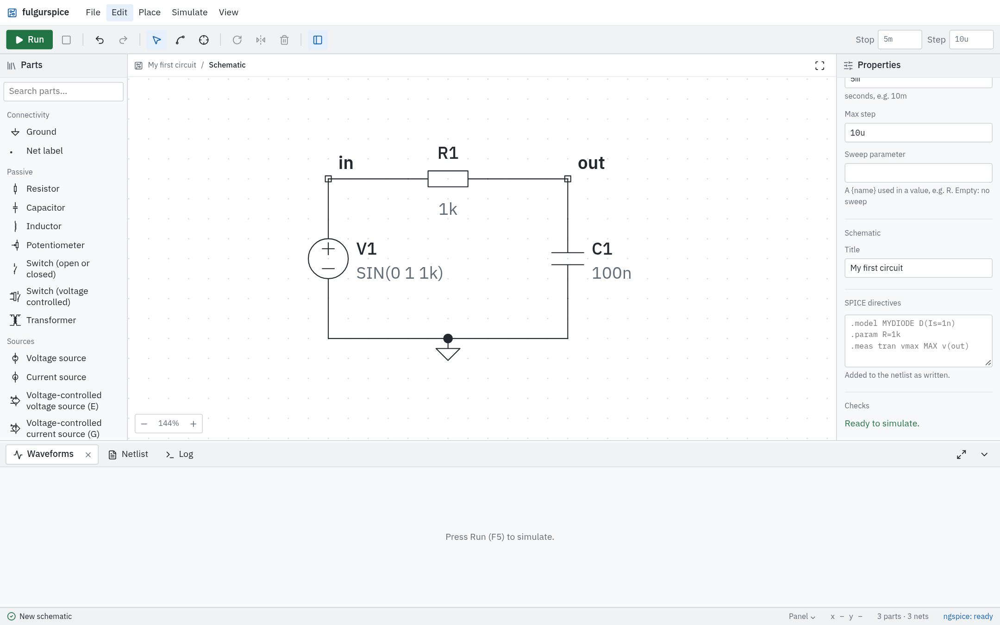

### Step 4: run

Press **`F5`** (or the green **Run** button). The labelled nodes are plotted for you.

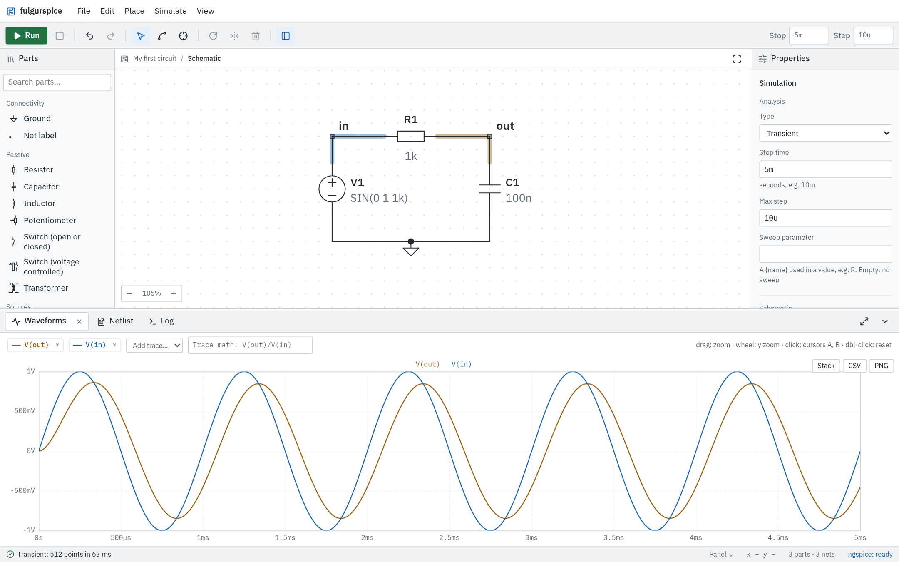

`V(out)` is smaller than `V(in)` and arrives later. That is the filter at work: 1 kHz is close to its
corner frequency, so about 85 % of the signal gets through.

Open the **Netlist** tab to see what was sent to ngspice. It is the file from section 1.

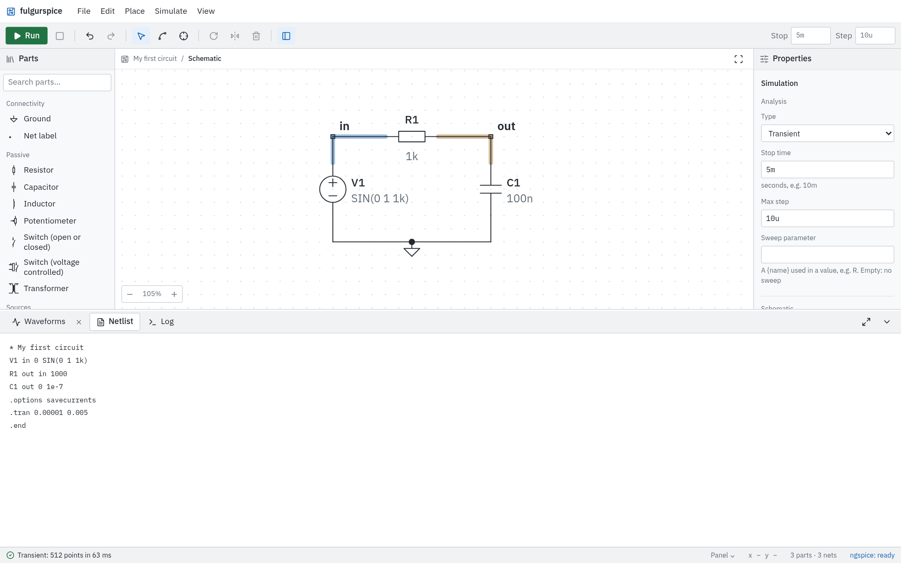

## 4. Operating point: the voltage divider

Open **File > Examples > Voltage divider — operating point** and press `F5`.

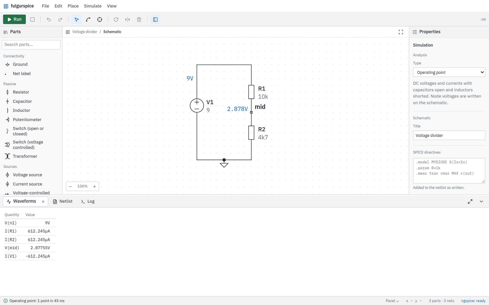

An operating point has no time axis. The node voltages are written **on the schematic**, and the table
lists every voltage and current.

Check it by hand: `V(mid) = 9 × 4.7k / (10k + 4.7k) = 2.878 V`, and the current is
`9 / 14.7k = 612 µA`.

**Why is `I(V1)` negative?** SPICE counts a current as positive when it flows *into* a part's first
pin and out of its second. A source that is delivering power pushes current *out* of its `+` pin, so
it reads negative. For resistors, capacitors and inductors the sign depends on which way round the
part is drawn; if a current looks upside down, that is why.

## 5. Transient: watching a capacitor charge

Open [`examples/rc-step.fspice.json`](examples/rc-step.fspice.json). The source is now a **pulse** that
jumps from 0 V to 5 V after 1 ms. With `R = 1k` and `C = 1u`, the time constant is `τ = RC = 1 ms`.

Select `V1` to see the pulse as separate fields. Editing a field rewrites the value text, and editing
the text updates the fields.

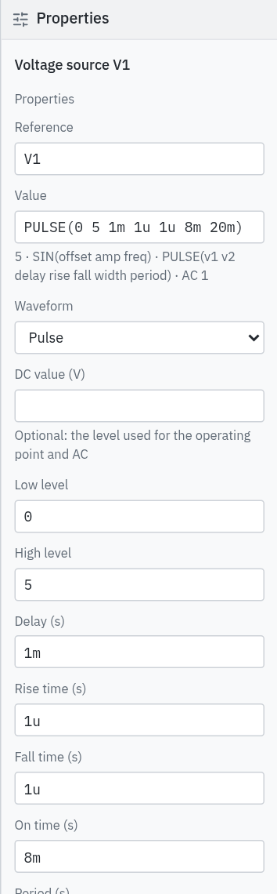

The analysis is set on the toolbar or in Properties:

| Field | Meaning | Here |
|---|---|---|
| Stop time | how long to simulate | `15m` |
| Max step | the time step; smaller gives smoother curves and longer runs | `10u` |

As a starting point, make the stop time a few periods or a few time constants, and the step about a
thousandth of it.

### Measure with cursors

Run it. **Click** the plot to place cursor **A**, click again for cursor **B**. The box shows both
readings, the difference, and `1/Δt`.

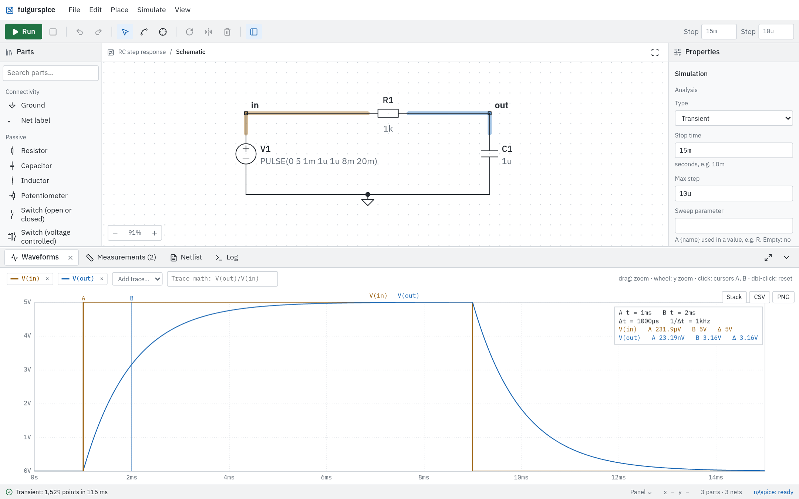

One time constant after the step, `V(out)` is 3.16 V: that is 63 % of 5 V, as theory says. A
right-click removes the cursors.

### Measure with `.meas`

Cursors are quick; `.meas` is exact and repeatable. This circuit has two lines under **SPICE
directives**:

```spice
.meas tran t63 TRIG v(in) VAL=2.5 RISE=1 TARG v(out) VAL=3.1606 RISE=1
.meas tran trise TRIG v(out) VAL=0.5 RISE=1 TARG v(out) VAL=4.5 RISE=1
```

The first times from the input passing 2.5 V to the output passing 3.16 V. The second is the 10 % to
90 % rise time. Open the **Measurements** tab:

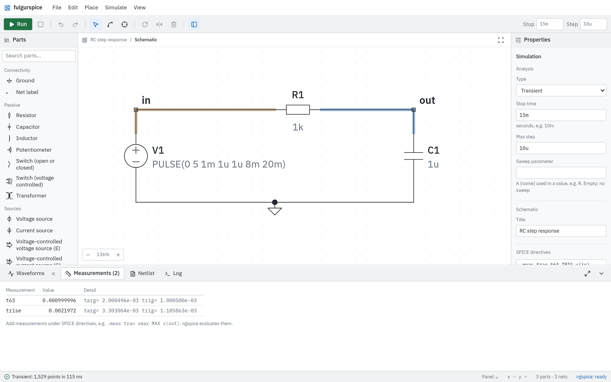

`t63` is 1.000 ms (one `τ`) and `trise` is 2.197 ms, which is the textbook `2.2 τ`.

## 6. AC sweep: the frequency response

An AC sweep answers "how much of each frequency gets through?" without simulating any waveform. Open
[`examples/rc-bode.fspice.json`](examples/rc-bode.fspice.json) and run it.

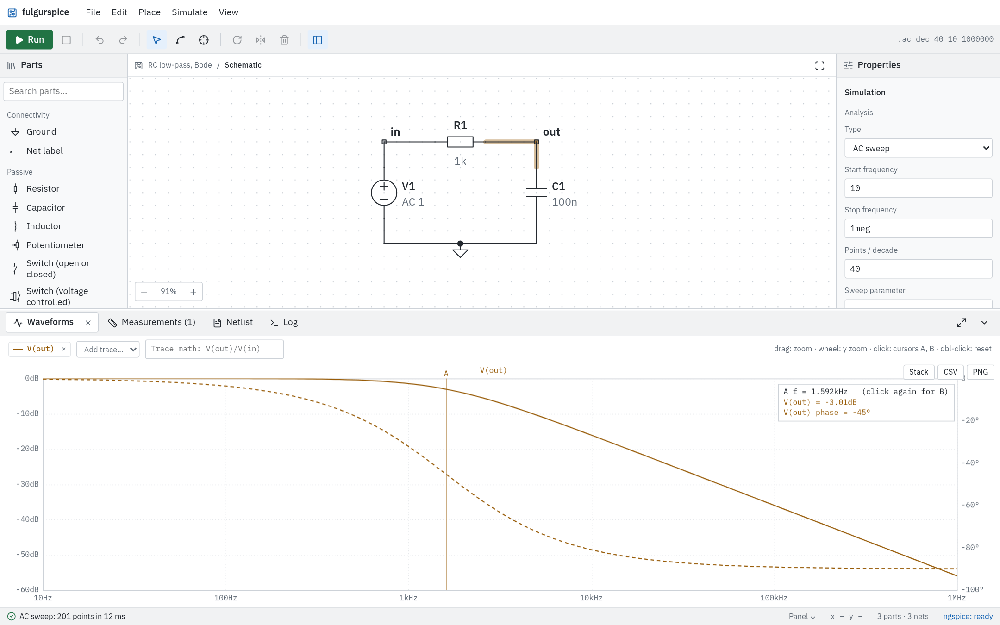

- The **solid** line is magnitude in decibels (left axis).
- The **dashed** line is phase in degrees (right axis).
- The frequency axis is logarithmic.

The corner frequency is where the gain is −3 dB: here 1.592 kHz, with −45° of phase. Theory gives
`1 / (2π × 1k × 100n) = 1592 Hz`. The example also measures it:

```spice
.meas ac f3db WHEN vdb(out)=-3.0103
```

Two rules for AC:

1. **A source needs an AC value**, such as `AC 1`, or tick *AC sweep stimulus* in the source editor.
   With none, the run succeeds but every trace is zero, and the app does not warn you.
2. With `AC 1`, the output voltage **is** the gain, so 0 dB means "unchanged".

AC analysis linearises the circuit around its operating point. It shows small-signal behaviour only:
no clipping and no distortion. It saves node voltages but **no part currents**.

| Field | Meaning | Here |
|---|---|---|
| Start frequency | | `10` |
| Stop frequency | | `1meg` |
| Points / decade | resolution | `40` |

## 7. DC sweep: diode curves

A DC sweep steps a source and solves the operating point at each value. Open
[`examples/diode-curves.fspice.json`](examples/diode-curves.fspice.json): `V1` is swept from 0 to 3 V
into a silicon diode and a red LED, each behind 100 Ω.

Run it, remove the voltage traces with their `×`, and choose `I(D1)` and `I(D2)` from **Add trace…**.

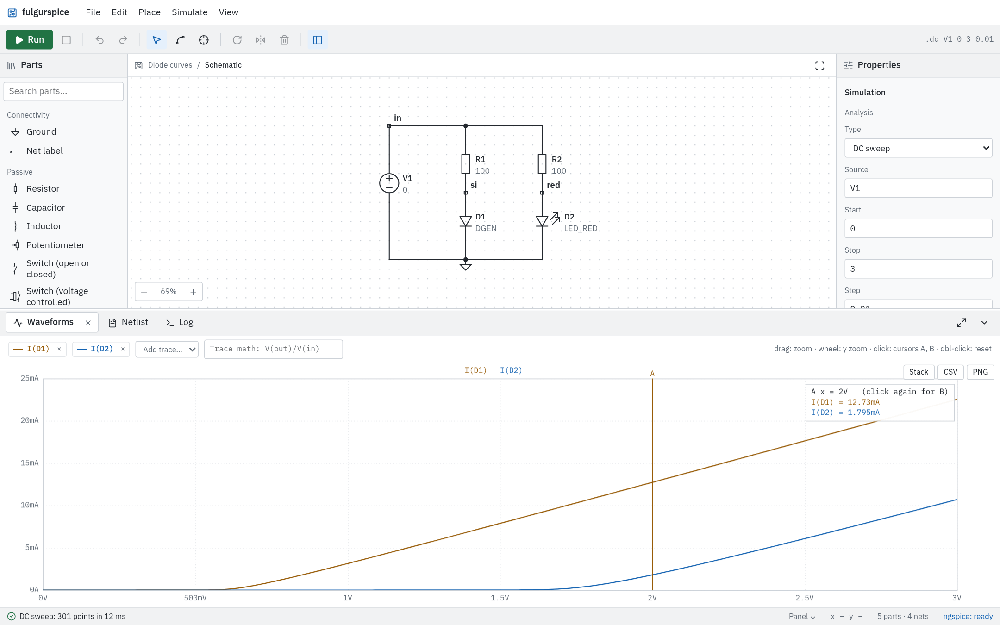

The silicon diode starts to conduct around 0.6 V, the red LED around 1.7 V. At 2 V from the source
they carry 12.7 mA and 1.8 mA.

| Field | Meaning | Here |
|---|---|---|
| Source | the reference of a V or I source | `V1` |
| Start, Stop, Step | the values to visit | `0`, `3`, `0.01` |

## 8. Probing, currents and trace math

Open **File > Examples > Half-wave rectifier** and run it.

### Probe

Press **`P`**, then:

- click a **wire** to plot its voltage;
- click a **part** to plot its current;
- click it again to remove the trace.

Plotted nets are highlighted on the sheet in the colour of their trace. Click the diode:

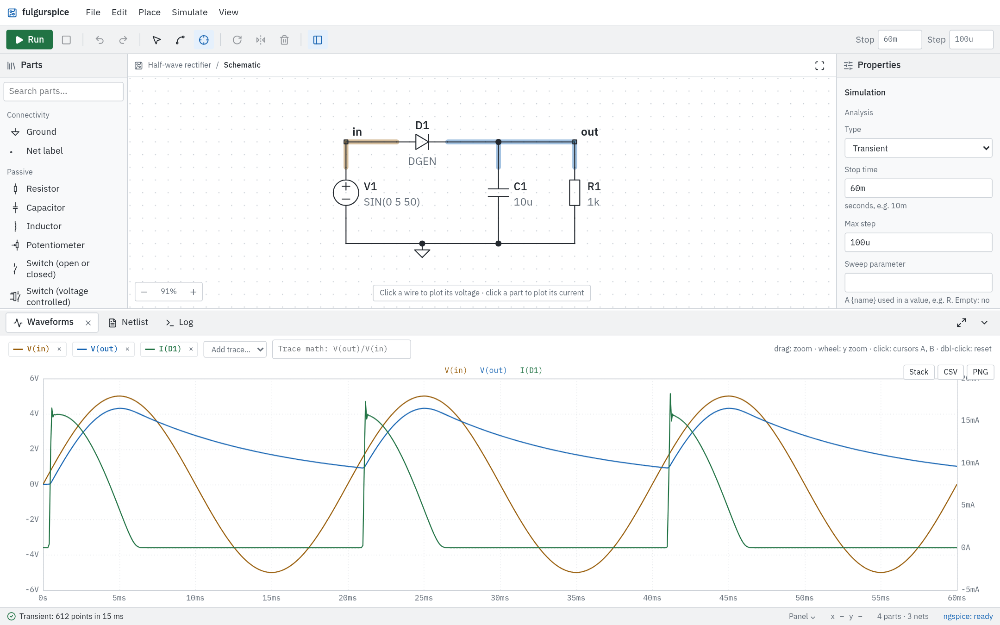

Voltages use the left axis and currents the right. The diode conducts only in short bursts, when the
input rises above the capacitor voltage.

### Stack

**Stack** gives each unit its own pane, sharing one time axis.

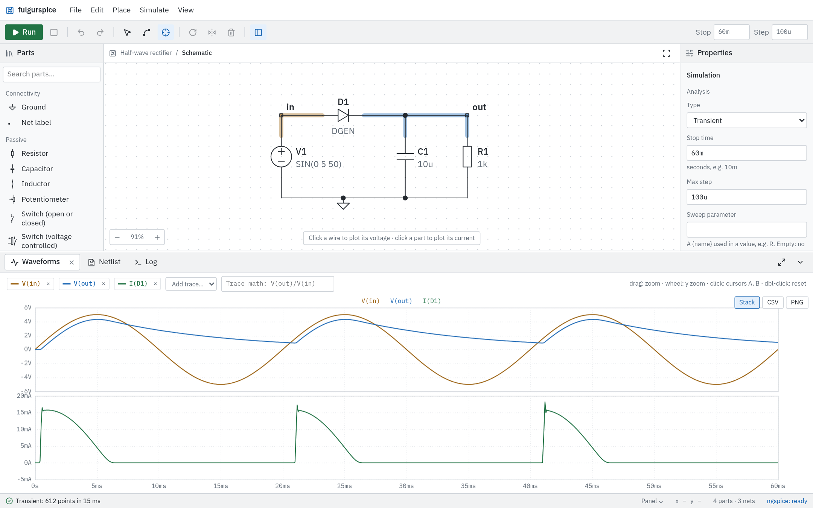

### Trace math

Type an expression in the **Trace math** box and press `Enter`. `V(in)-V(out)` is the voltage across
the diode:

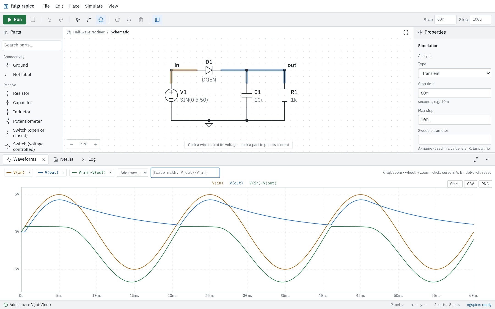

| You can write | Example |
|---|---|
| `+ - * /` and brackets | `V(in)-V(out)` |
| power | `V(in)*I(V1)` (shown in W) |
| gain | `V(out)/V(in)` |
| `abs`, `sqrt` | `abs(I(D1))` |
| `db`, `ph`, `re`, `im` (for AC) | `ph(V(out)/V(in))` |
| SPICE numbers | `V(out)*10m` |

### Measure the ripple

Add these under **SPICE directives** and run again:

```spice
.meas tran ripple PP v(out) from=40m to=60m
.meas tran vavg AVG v(out) from=40m to=60m
```

| `C1` | Ripple (peak to peak) | Average output |
|---|---|---|
| `10u` | 3.38 V | 2.43 V |
| `100u` | 0.70 V | 3.94 V |

Change `C1` and try it: a bigger capacitor holds the voltage up better between peaks.

## 9. Parameter sweeps

To compare several values in one plot:

1. Write the value as a name in braces: set `R1` to `{R}`.
2. With nothing selected, set **Sweep parameter** to `R`.
3. Set **Sweep values**.

| Sweep values | Meaning |
|---|---|
| `1k 2k 4.7k` | exactly these |
| `lin 1k 10k 4` | 4 values, evenly spaced |
| `dec 100 10k 3` | 3 values per decade |

[`examples/rc-sweep.fspice.json`](examples/rc-sweep.fspice.json) is set up this way.

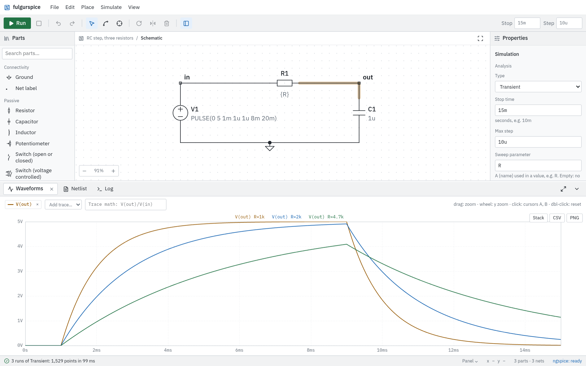

A larger resistor means a longer time constant. A sweep is limited to 12 runs, and works with
transient, AC and DC analyses. (ngspice has no `.step` command, so the app runs the circuit once per
value.)

## 10. A transistor amplifier

[`examples/common-emitter.fspice.json`](examples/common-emitter.fspice.json) is a classic
common-emitter stage. Simulate it in two steps, as you would on a bench.

### First check the bias

Set the analysis **Type** to *Operating point* and run.

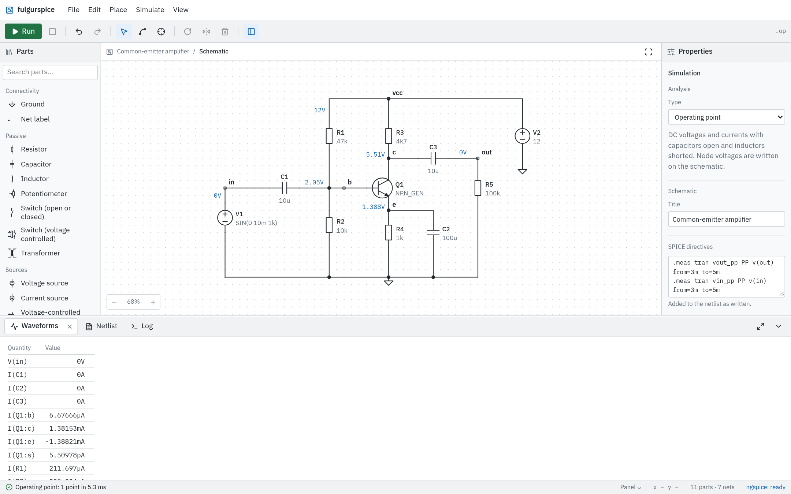

| Node | Voltage | What it tells you |
|---|---|---|
| base `b` | 2.05 V | set by the `R1`/`R2` divider |
| emitter `e` | 1.39 V | about 0.66 V below the base: the transistor is on |
| collector `c` | 5.51 V | between 12 V and the emitter, so there is room to swing both ways |

The collector current `I(Q1:c)` is 1.38 mA. If the collector sat near 12 V or near the emitter, the
amplifier would clip, and there would be no point simulating signals yet.

### Then the signal

Set **Type** back to *Transient* with stop `5m` and step `5u`, run, and plot `V(in)` and `V(out)`.

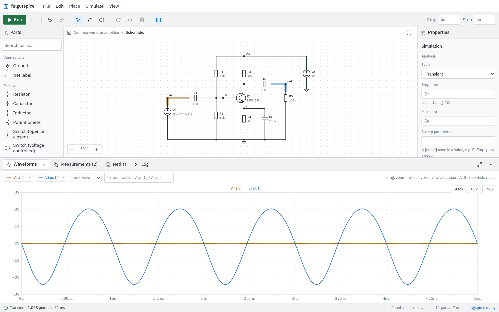

The 10 mV input is almost a flat line next to the output, which is inverted. The measurements give
20 mV peak to peak in and 4.44 V out: a **gain of about 222**.

The negative half (−2.4 V) is larger than the positive half (+2.0 V). That is distortion, because a
transistor is not linear.

**Try it:** delete `C2`, the capacitor across the emitter resistor, and its wires. The gain falls to
about 4.4, close to `R3 / R4`, and the output becomes far more linear.

## 11. An op-amp that clips

There are two op-amp parts:

| Part | Behaviour | Use it for |
|---|---|---|
| Op-amp (ideal) | fixed gain, no supplies, never clips | learning the ideal equations |
| Op-amp with supplies | needs `V+` and `V-`, clips at the rails, 1 MHz gain-bandwidth | anything realistic |

[`examples/opamp-clipping.fspice.json`](examples/opamp-clipping.fspice.json) is an inverting
amplifier with gain −10 on ±5 V supplies, driven with 1 V. It would need ±10 V.

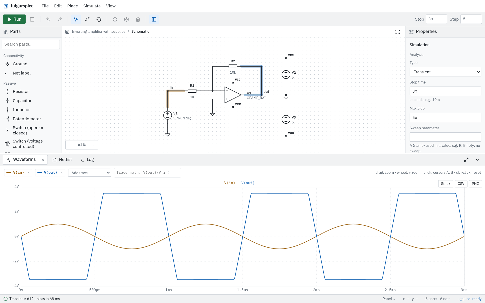

`OPAMP_RAIL` stops 1.5 V inside each rail, at ±3.5 V. Note how the supplies are drawn: two sources on
the side, joined to the op-amp by the labels `vcc` and `vee`.

**Try it:** change the model to `OPAMP_RR` (rail to rail) and the output reaches about ±4.98 V. Set
the input to `SIN(0 0.2 1k)` and the clipping disappears.

## 12. Subcircuits

A subcircuit is a circuit drawn once and used as a part. Open **File > Examples > Two RC stages from
one subcircuit**.

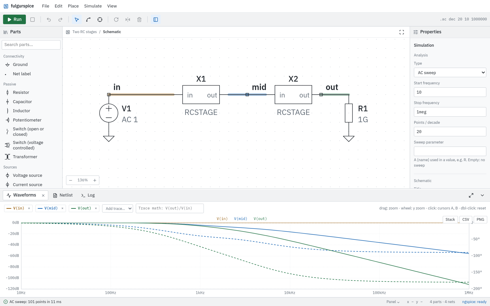

**Double-click** a box (or use **Place > Edit subcircuit**) to open its sheet:

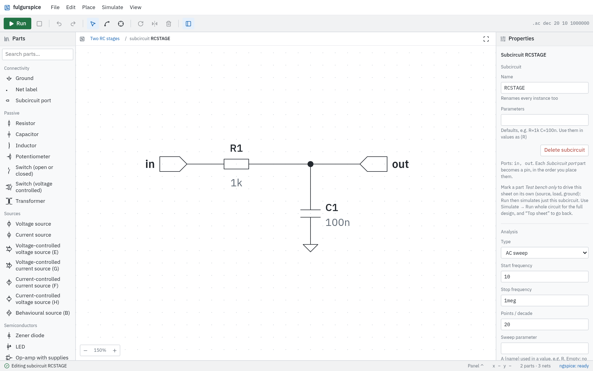

Press `Esc`, or click the title in the breadcrumb, to return. In the netlist this becomes:

```spice
.subckt RCSTAGE in out
R1 out in 1000
C1 out 0 1e-7
.ends RCSTAGE
V1 in 0 AC 1
X1 in mid RCSTAGE
X2 mid out RCSTAGE
```

### Make your own

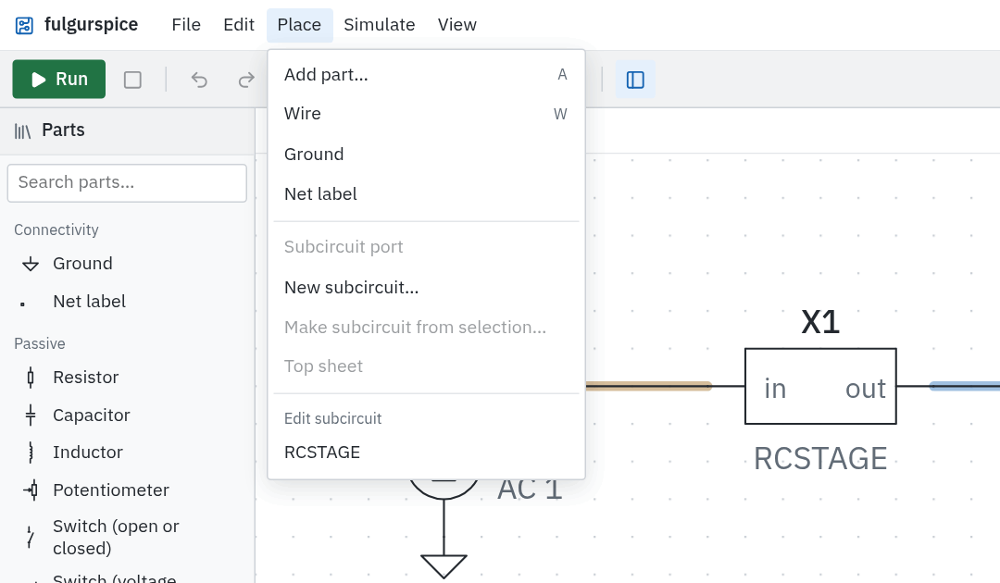

- **From parts you have drawn:** select them, then **Place > Make subcircuit from selection…**. Wires
  that cross the selection's edge become ports. Each port pin must lead to a real part: if it only
  meets a net label, add a load.
- **From an empty sheet:** **Place > New subcircuit…**, draw the inside, and add a **Subcircuit port**
  for each pin. Pins appear in the order you place the ports.

### Parameters

On the subcircuit sheet, set **Parameters** to defaults such as `R=1k`, and use `{R}` in a part value.
Each placed box can override it in its own **Parameters** field, such as `R=3k`. See the example
**Subcircuit with parameters — two dividers**.

### Test bench

To try a subcircuit on its own, add a source, load and ground on its sheet, select them and tick
**Test bench only**. `F5` then simulates just that sheet, and those parts are left out wherever the
subcircuit is used. **Simulate > Run whole circuit** runs the full design.

## 13. When something is wrong

The app checks the circuit before ngspice sees it. Problems are listed under **Checks**, and the
parts involved are drawn in red. Click a message to select its part.

Open [`examples/mistakes.fspice.json`](examples/mistakes.fspice.json), which is broken on purpose.

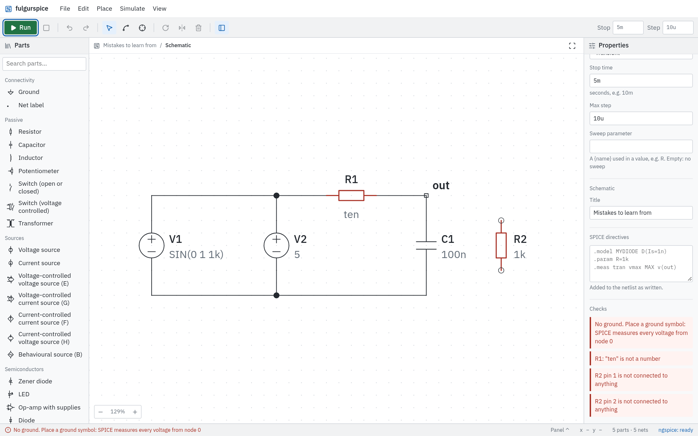

Fix it one message at a time:

1. *No ground* → place a ground symbol on the bottom wire.
2. *R1: "ten" is not a number* → set it to `1k`.
3. *R2 pin 1 is not connected to anything* → `R2` is a stray part: delete it.

A new message then appears, which could not be checked until the rest was fixed:

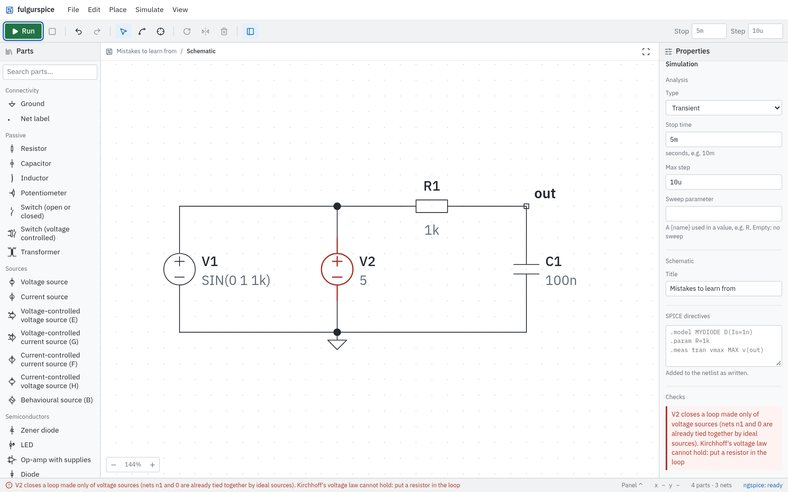

4. Two ideal voltage sources are forced onto the same two nodes with different voltages. Delete `V2`.

It now simulates. The status bar keeps the last message until you press Run again.

### Common messages

| Message | Why | Fix |
|---|---|---|
| No ground | there is no node 0 | add a ground symbol |
| pin … is not connected to anything | a pin leads nowhere | wire it, or delete the part |
| Two parts are called … | references must be unique | rename one |
| is not a number | a value SPICE cannot read | check the suffix |
| … uses X, which is not defined | `{X}` has no value | add `.param X=…`, a subcircuit parameter, or a sweep |
| loop made only of voltage sources | Kirchhoff's voltage law cannot hold | put a resistor in the loop |
| pushes current into part of the circuit that has no other way back | Kirchhoff's current law cannot hold | give the current a path |
| has no DC path to ground (warning) | a floating node, often between capacitors | add a large resistor to ground |
| inductor forms a loop with ideal voltage sources (warning) | an inductor is a short at DC | add a small series resistor |
| A part names a model that is not defined | misspelt model | use a built-in name or add a `.model` line |
| timestep too small | the solver could not converge | smaller step, add series resistance |
| ngspice stopped answering | a directive or expression it cannot read | check directives and behavioural sources |

**Stop** ends a run that is taking too long, and the app gives up by itself after 60 seconds. The
**Log** tab holds ngspice's own output.

## 14. Reference: parts

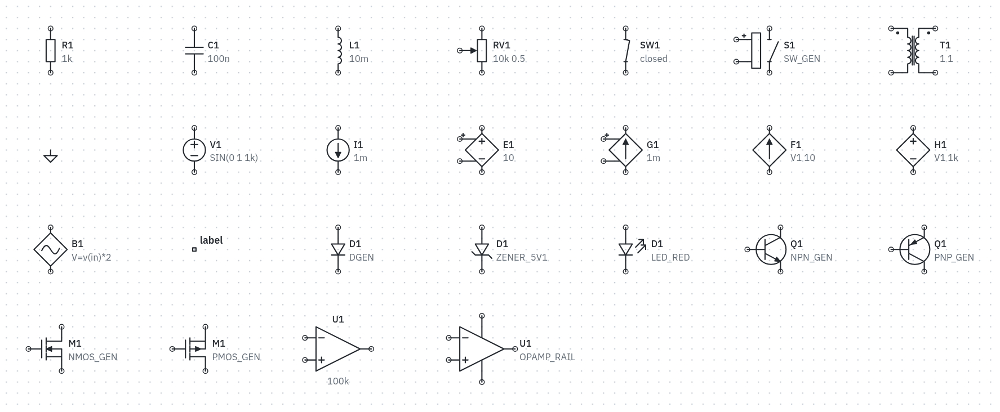

| Part | Ref | Value | Notes |
|---|---|---|---|
| Resistor | `R` | `1k` | |
| Capacitor | `C` | `100n` | |
| Inductor | `L` | `10m` | |
| Potentiometer | `RV` | `10k 0.3` | total resistance, wiper position from pin 1 (between 0 and 1) |
| Switch (manual) | `SW` | `closed` or `open` | 1 mΩ or 1 GΩ |
| Switch (voltage controlled) | `S` | `SW_GEN` | closes when `C+` − `C−` passes about 2.5 V |
| Transformer | `T` | `1 2 0.99` | primary inductance (H), secondary/primary turns ratio, coupling (default 0.999). Give the secondary a path to ground |
| Voltage / current source | `V` / `I` | see [section 15](#15-reference-sources) | current flows from the top pin through an `I` source to the bottom |
| Controlled sources | `E` `G` `F` `H` | see below | |
| Behavioural source | `B` | `V=v(in)*2` | see below |
| Diode, zener, LED | `D` | model name | |
| NPN, PNP | `Q` | model name | |
| N and P MOSFET | `M` | model name | body tied to source |
| Op-amp (ideal) | `U` | `100k` | open-loop gain |
| Op-amp with supplies | `U` | model name | |
| Ground | | | node 0 |
| Net label | | name | same name, same node |

### Built-in models

These are generic models written for this project. They behave sensibly, but **they are not any
manufacturer's part**: do not rely on them to predict a particular component.

| Model | Behaviour |
|---|---|
| `DGEN` | silicon diode, about 0.7 V forward |
| `ZENER_5V1` | breaks down at 5.1 V in reverse |
| `LED_RED` | about 1.9 V at 10 mA |
| `NPN_GEN`, `PNP_GEN` | small-signal transistor, β about 200 |
| `NMOS_GEN`, `PMOS_GEN` | threshold ±1.5 V |
| `SW_GEN` | on 1 mΩ, off 1 GΩ, threshold 2.5 V with 0.2 V hysteresis |
| `OPAMP_RAIL` | 100 dB, 1 MHz, swings to 1.5 V inside the rails |
| `OPAMP_RR` | the same, rail to rail |

Neither op-amp model includes slew rate or an output current limit.

### Controlled sources

| Part | Value | Output |
|---|---|---|
| `E` voltage from voltage | `10` | `10 × (V(C+) − V(C−))` volts |
| `G` current from voltage | `1m` | `1m × (V(C+) − V(C−))` amps |
| `F` current from current | `V1 10` | 10 × the current through `V1` |
| `H` voltage from current | `V1 1k` | 1000 × the current through `V1`, in volts |

`F` and `H` measure current through a voltage source on the same sheet. To measure a branch, put a
**0 V source** in it as an ammeter.

### Behavioural sources

Write `V=` or `I=` followed by an expression:

```
V=v(in)*2+1
I=v(a,b)/1k
V=min(max(v(in), -1), 1)
V=v(in) > 0 ? 5 : 0
V=sin(2*pi*1k*time)
```

| Allowed | |
|---|---|
| Signals | `v(net)`, `v(a,b)`, `i(V1)`, `time`, `temper`, `pi`, `e`, `{param}` |
| Operators | `+ - * / ^ **`, comparisons, `&& \|\| !`, `a ? b : c` |
| One argument | `abs sqrt sin cos tan asin acos atan sinh cosh tanh exp ln log log10 sgn u uramp floor ceil nint` |
| Two arguments | `pow(a,b) pwr(a,b) min(a,b) max(a,b)` |

`log` is the natural logarithm, the same as `ln`.

> **Do not use `limit()`.** The app accepts it, but in ngspice it does not clamp: `limit(0.2, -1, 1)`
> gives −0.8. To clamp, write `min(max(x, lo), hi)`.

The app checks the whole expression first, because ngspice can stall on a mistake. One case it cannot
catch: `sqrt()` of a signal that goes negative during the run. Write `sqrt(abs(v(x)))` or
`sqrt(uramp(v(x)))`.

## 15. Reference: sources

| Value | Meaning |
|---|---|
| `5` or `DC 5` | constant 5 V |
| `SIN(0 1 1k)` | sine: offset 0, amplitude 1, 1 kHz |
| `SIN(0 1 1k 1m 100 90)` | …after a 1 ms delay, damping 100 /s, phase 90° |
| `PULSE(0 5 1m 1u 1u 8m 20m)` | low, high, delay, rise, fall, on time, period |
| `PWL(0 0 1m 5 2m 0)` | straight lines through (time, value) pairs; times must increase |
| `AC 1` | stimulus for an AC sweep |
| `DC 2 AC 1` | 2 V bias plus AC stimulus |

**Which part of the value is used?** Transient uses the waveform. Operating point uses the DC value,
or the waveform's starting value when there is none. AC uses `AC`, around that operating point. A DC
sweep replaces the swept source's value.

The source editor covers DC, sine, pulse, piecewise linear and AC. Other SPICE forms, such as `EXP`
or `SFFM`, can be typed into the value field.

## 16. Reference: SPICE directives

With nothing selected, the **SPICE directives** box adds lines to the netlist exactly as written.

> The app checks your schematic, but **not these lines**. A mistake here can stall ngspice until the
> 60-second limit. Write numbers as `4.7k`, never `4k7`.

### `.param`: named values

```spice
.param R=4.7k
```

Then set a resistor's value to `{R}` or `{R*2}`.

### `.model`: your own device

```spice
.model MYDIODE D(Is=1n N=1.8 Rs=1)
```

Then set a diode's **Model** to `MYDIODE`. You can paste a `.model` line from a manufacturer this
way; check its licence, and expect that some are written for other simulators.

### `.subckt`: a macromodel as an op-amp

*Op-amp with supplies* calls the subcircuit named in its model field, with the pins in this order:
`+`, `−`, `out`, `V+`, `V−`. Many published op-amp macromodels use a different order, so wrap them:

```spice
.subckt VENDOR inp inn vcc vee out
* ... the published model goes here ...
.ends
.subckt MYOPAMP inp inn out vcc vee
X1 inp inn vcc vee out VENDOR
.ends
```

Then set the op-amp's **Model** to `MYOPAMP`. The wrapper has been tried with a stand-in model, not
with any particular manufacturer's file.

### `.meas`: measurements

| Line | Measures |
|---|---|
| `.meas tran vmax MAX v(out)` | largest value (also `MIN`) |
| `.meas tran ripple PP v(out) from=40m to=60m` | peak to peak in a window |
| `.meas tran vavg AVG v(out)` | average (also `RMS`) |
| `.meas tran t1 WHEN v(out)=3 RISE=1` | when a level is first crossed going up |
| `.meas tran td TRIG v(in) VAL=2.5 RISE=1 TARG v(out) VAL=2.5 RISE=1` | delay between two events |
| `.meas ac fc WHEN vdb(out)=-3.0103` | corner frequency |
| `.meas ac g1k FIND vdb(out) AT=1k` | gain at one frequency |
| `.meas tran ipk MIN i(v1)` | current through a voltage source |

`.meas` cannot read a part current such as `I(R1)`: put a 0 V source in the branch and measure
`i(v2)` or whatever you called it. A measurement that cannot be evaluated is marked *failed*; the
waveforms are still good.

## 17. Reference: editor and plot

### Keyboard

| Key | Action |
|---|---|
| `A` | add a part |
| `W` | wire |
| `P` | probe |
| `R`, `X` | rotate, mirror |
| `F` or `Home` | fit the drawing |
| `Esc` | stop the current tool; with nothing to stop, leave a subcircuit sheet |
| `Delete` | delete the selection |
| `Shift+Delete` | delete one segment of a selected wire (point at it) |
| `Ctrl+Z`, `Ctrl+Y` | undo, redo |
| `Ctrl+C`, `Ctrl+X`, `Ctrl+V`, `Ctrl+D` | copy, cut, paste, duplicate |
| `Ctrl+S` | save to a file |
| `F5` or `Ctrl+Enter` | run |
| `Ctrl+J` | show or hide the results panel |

### Mouse on the sheet

| Action | Result |
|---|---|
| wheel | zoom |
| drag with the middle button | pan |
| click, `Shift`+click | select, add to the selection |
| drag a box left to right | select what is fully inside |
| drag a box right to left | select everything it touches |
| drag a part or wire | move it; attached wires stretch |
| drag the text of a selected part | move the label |
| double-click a subcircuit | open it |
| right-click | cancel the current tool |

### Mouse on the plot

| Action | Result |
|---|---|
| drag | zoom the horizontal axis |
| wheel | zoom the vertical axis under the pointer |
| `Shift`+wheel | zoom the horizontal axis |
| click, click | cursor A, cursor B |
| right-click | remove cursors |
| double-click | reset zoom and cursors |

**CSV** saves the plotted traces for a spreadsheet; **PNG** saves the picture.

### Saving

Your work is saved in the browser as you go. To keep a copy, move it to another computer or share it,
use **File > Save**, which downloads a `.fspice.json` file.

## 18. Taking your netlist elsewhere

The **Netlist** tab is ordinary SPICE. Copy it into a file and load it in desktop ngspice
(`ngspice circuit.cir`, then `run` and `plot v(out)`) to check a result, or use it as the starting
point for another tool.
Built-in models are included in the netlist, so nothing else is needed.

To go further, the [ngspice manual](https://ngspice.sourceforge.io/docs.html) documents every element
and command. Remember that it describes the full simulator: the app supplies the analysis line itself,
so choose analyses in Properties rather than adding them as directives.
